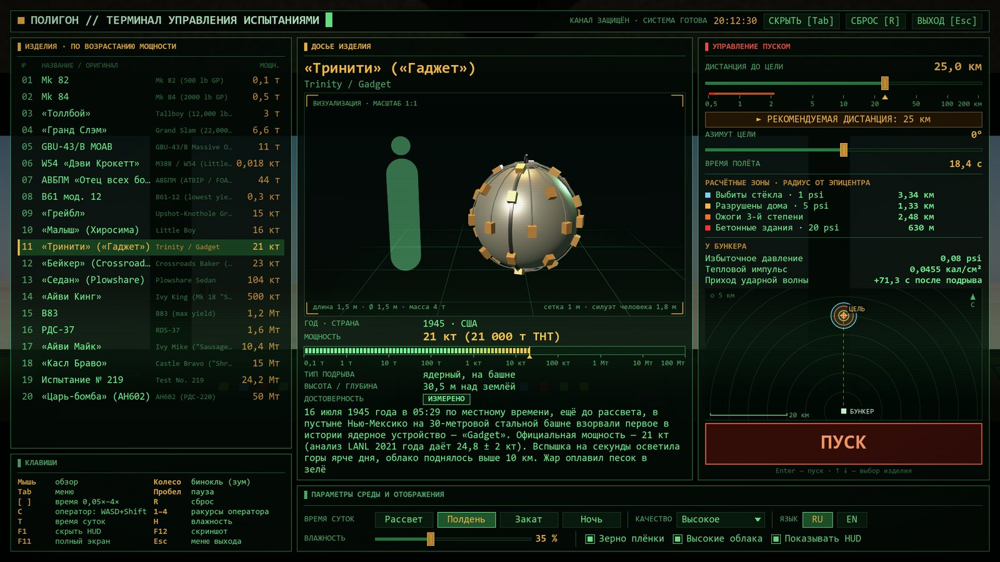

# How to run the game — a beginner's guide

> 🇷🇺 Русский: [HOW_TO_RUN_RU.md](HOW_TO_RUN_RU.md)

You don't need Godot, Python or anything else. The whole game is one file, `AtomicBombs.exe`.

## 1. Check your PC

- **Windows 10 or 11, 64-bit.** To check: Start → Settings → System → About → "System type".
- **A GPU with DirectX 12 support.** The explosions are heavy graphics: the stronger the GPU, the smoother. On a
  weak GPU lower the quality in the menu (see section 5).
- **Update your graphics driver** (NVIDIA App, AMD Adrenalin or Intel). An old driver is the most common reason a
  game will not start.

## 2. Download the game

1. Click: **[Download AtomicBombs.exe](https://github.com/Prokopiy8247/Opus5-5-Atomic-Bombs/releases/latest/download/AtomicBombs.exe)**
   (~119 MB). Or open the [Releases](https://github.com/Prokopiy8247/Opus5-5-Atomic-Bombs/releases/latest) page and
   click `AtomicBombs.exe` under **Assets**.
2. Your browser may warn that the file is not commonly downloaded. That is because it is new and has no paid code
   signature. Choose "Keep" / "Keep anyway".
3. Put the file wherever you like, for example on the Desktop.

## 3. Run it

1. Double-click `AtomicBombs.exe`.
2. If a blue **"Windows protected your PC"** window appears, click **"More info"**, then **"Run anyway"**. Windows
   shows this for any program without a paid signing certificate. It does not mean the file is dangerous.
3. On the first start your antivirus may scan the file for a few seconds, and the game briefly shows
   "WARMING UP SHADERS…". That is normal.

## 4. Your first explosion in 30 seconds



*(The menu starts in Russian; switch to English with **EN** at the bottom right.)*

1. The terminal menu opens. **On the left** is the list of 20 bombs — click any (or use ↑ ↓).
2. **On the right** click "► RECOMMENDED RANGE" — safe and with a good view. If you place the bomb too close, the
   game asks you to confirm: the bunker may be destroyed.
3. Press the big red **LAUNCH** button (or Enter).
4. Watch through the bunker window. **Mouse wheel** = binoculars. The sound arrives after the flash, as in real
   life: at long range it takes tens of seconds, and a small bomb far away may not be audible at all.
5. **Tab** opens the menu again to pick another bomb. **R** resets.
6. Language: **RU / EN** at the bottom right.

### Main keys

| Key | What it does |
|---|---|
| Mouse | look around |
| Mouse wheel | binoculars (zoom) |
| Tab | menu |
| Space | pause |
| `[` / `]` | slow down / speed up time |
| C | free camera outside (WASD, Q/E) |
| 1–4 | camera angles: bunker, side, low, orbit |
| T / H | time of day / humidity |
| F1 | hide the interface |
| F11 | full screen ↔ window |
| F12 | screenshot |
| Esc | quit the game (asks first) |

Full list: [README](README_EN.md#-controls).

## 5. If something goes wrong

- **The game does not open or closes at once.** Update your graphics driver and check that Windows is 64-bit.
  The log of the last run is in `%APPDATA%\Godot\app_userdata\Atomic Bombs Opus 5.5\logs` — paste this path into
  the File Explorer address bar.
- **The antivirus blocked the file.** Unsigned exe files (Godot games especially) sometimes get false positives.
  If you downloaded it from here, you can restore it from quarantine and add an exclusion. You can check that the
  file is genuine with its checksum (section 7).
- **It lags.** In the menu at the bottom set "QUALITY" lower and turn off "High clouds". On a laptop plug in the
  charger and run the game on the dedicated GPU: Settings → System → Display → Graphics → `AtomicBombs.exe` →
  "High performance".
- **No sound.** Check the Windows output device. Remember the sound travels at the speed of sound: from 20 km it
  arrives about a minute later.
- **Where are my screenshots (F12)?** In `%APPDATA%\Godot\app_userdata\Atomic Bombs Opus 5.5\screenshots`.

## 6. How to remove it

Just delete `AtomicBombs.exe`: the game installs nothing. To remove everything, also delete the folder
`%APPDATA%\Godot\app_userdata\Atomic Bombs Opus 5.5` (screenshots, logs and the shader cache).

## 7. Check the file is genuine (optional)

Open PowerShell in the folder with the file and run:

```powershell
Get-FileHash .\AtomicBombs.exe
```

The `Hash` value must match the SHA256 on the [release](https://github.com/Prokopiy8247/Opus5-5-Atomic-Bombs/releases/latest) page.

---

To run from source or build the exe yourself, see ["For developers"](README_EN.md#️-for-developers) in the README.
