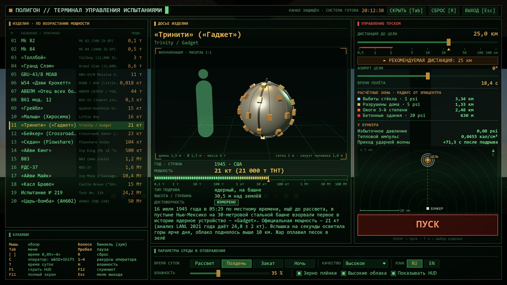

# Как запустить игру — гайд для новичков

> 🇬🇧 English: [HOW_TO_RUN_EN.md](HOW_TO_RUN_EN.md)

Godot, Python и прочие программы не нужны. Вся игра — один файл `AtomicBombs.exe`.

## 1. Проверь компьютер

- **Windows 10 или 11, 64 бит.** Где посмотреть: Пуск → Параметры → Система → О системе → «Тип системы».
- **Видеокарта с поддержкой DirectX 12.** Взрывы — тяжёлая графика: чем мощнее видеокарта, тем плавнее.
  На слабой видеокарте понизь качество в меню (см. раздел 5).
- **Обнови драйвер видеокарты** (NVIDIA App, AMD Adrenalin или Intel). Старый драйвер — самая частая причина
  проблем с запуском.

## 2. Скачай игру

1. Нажми: **[Скачать AtomicBombs.exe](https://github.com/Prokopiy8247/Opus5-5-Atomic-Bombs/releases/latest/download/AtomicBombs.exe)**
   (~119 МБ). Можно и через страницу [Releases](https://github.com/Prokopiy8247/Opus5-5-Atomic-Bombs/releases/latest):
   там в разделе **Assets** нажми `AtomicBombs.exe`.
2. Браузер может предупредить, что такой файл скачивают редко. Это потому, что файл новый и без платной
   цифровой подписи. Выбери «Сохранить» / «Всё равно сохранить».
3. Положи файл куда удобно, например на Рабочий стол.

## 3. Запусти

1. Дважды щёлкни по `AtomicBombs.exe`.
2. Если появится синее окно **«Система Windows защитила ваш компьютер»**: нажми **«Подробнее»**, затем
   **«Выполнить в любом случае»**. Так Windows реагирует на любые программы без платного сертификата подписи.
   Это не значит, что файл опасный.
3. При первом запуске антивирус может проверять файл несколько секунд, а игра ненадолго покажет
   «ПРОГРЕВ ШЕЙДЕРОВ…». Это нормально.

## 4. Первый взрыв за 30 секунд



1. Откроется меню-терминал. **Слева** список из 20 бомб — щёлкни любую (или выбери стрелками ↑ ↓).
2. **Справа** нажми «► РЕКОМЕНДУЕМАЯ ДИСТАНЦИЯ» — с неё безопасно и хорошо видно. Если поставить бомбу слишком
   близко, игра попросит подтверждение: бункер может разрушиться.
3. Нажми большую красную кнопку **ПУСК** (или Enter).
4. Смотри в окно бункера. **Колесо мыши** — бинокль. Звук приходит позже вспышки, как в жизни: на большой
   дистанции он идёт десятки секунд, а от маленькой бомбы издалека его может быть совсем не слышно.
5. **Tab** — снова открыть меню и выбрать другую бомбу. **R** — сброс.
6. Язык меняется внизу справа: **RU / EN**.

### Главные клавиши

| Клавиша | Что делает |
|---|---|
| Мышь | осмотреться |
| Колесо мыши | бинокль (зум) |
| Tab | меню |
| Пробел | пауза |
| `[` / `]` | замедлить / ускорить время |
| C | свободная камера снаружи (WASD, Q/E) |
| 1–4 | ракурсы: бункер, сбоку, снизу, облёт |
| T / H | время суток / влажность |
| F1 | скрыть интерфейс |
| F11 | полный экран ↔ окно |
| F12 | скриншот |
| Esc | выйти из игры (с подтверждением) |

Полный список — в [README](README.md#-управление).

## 5. Если что-то не так

- **Игра не открывается или сразу закрывается.** Обнови драйвер видеокарты и проверь, что Windows 64-битная.
  Лог последнего запуска лежит в `%APPDATA%\Godot\app_userdata\Atomic Bombs Opus 5.5\logs` — этот путь можно
  вставить в адресную строку Проводника.
- **Антивирус заблокировал файл.** У неподписанных exe (особенно у игр на Godot) бывают ложные срабатывания.
  Если скачивал отсюда, файл можно восстановить из карантина и добавить в исключения. Подлинность можно проверить
  по контрольной сумме (раздел 7).
- **Тормозит.** В меню внизу поставь «КАЧЕСТВО» ниже и выключи «Высокие облака». На ноутбуке подключи зарядку и
  включи для игры дискретную видеокарту: Параметры → Система → Дисплей → Графика → `AtomicBombs.exe` →
  «Высокая производительность».
- **Нет звука.** Проверь устройство вывода звука в Windows. Помни, что звук идёт со скоростью звука: на 20 км
  он придёт примерно через минуту.
- **Где мои скриншоты (F12)?** В `%APPDATA%\Godot\app_userdata\Atomic Bombs Opus 5.5\screenshots`.

## 6. Как удалить

Просто удали `AtomicBombs.exe`: игра ничего не устанавливает. Если хочешь убрать вообще всё, удали ещё папку
`%APPDATA%\Godot\app_userdata\Atomic Bombs Opus 5.5` — там скриншоты, логи и кэш шейдеров.

## 7. Проверить, что файл оригинальный (необязательно)

Открой PowerShell в папке с файлом и выполни:

```powershell
Get-FileHash .\AtomicBombs.exe
```

Значение `Hash` должно совпасть с SHA256 на странице [релиза](https://github.com/Prokopiy8247/Opus5-5-Atomic-Bombs/releases/latest).

---

Хочешь запустить из исходников или собрать exe сам — смотри раздел [«Для разработчиков»](README.md#️-для-разработчиков) в README.
