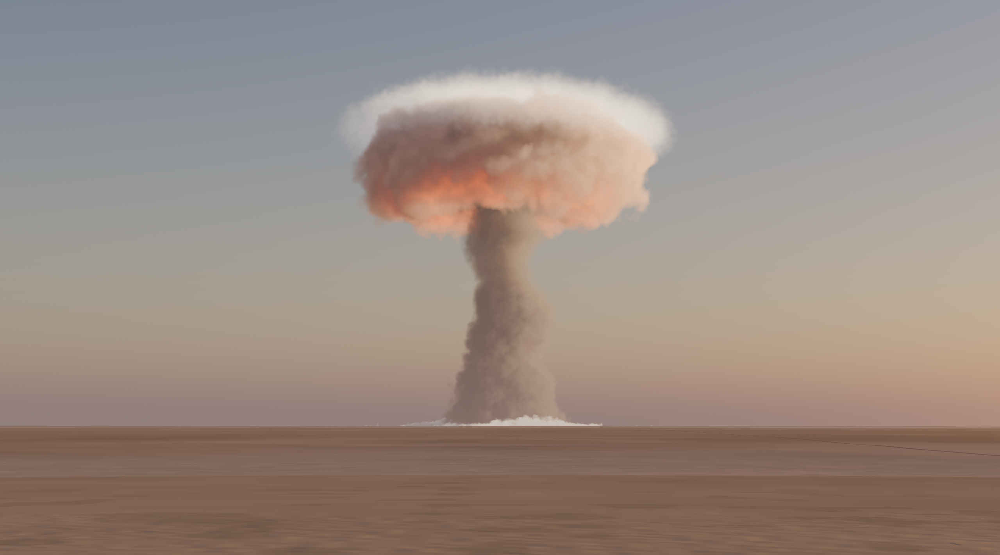
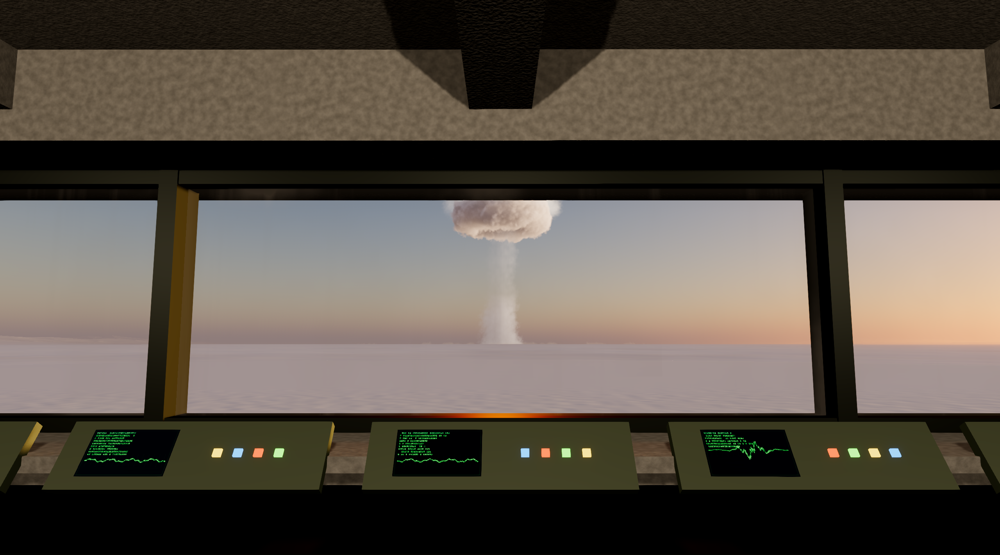
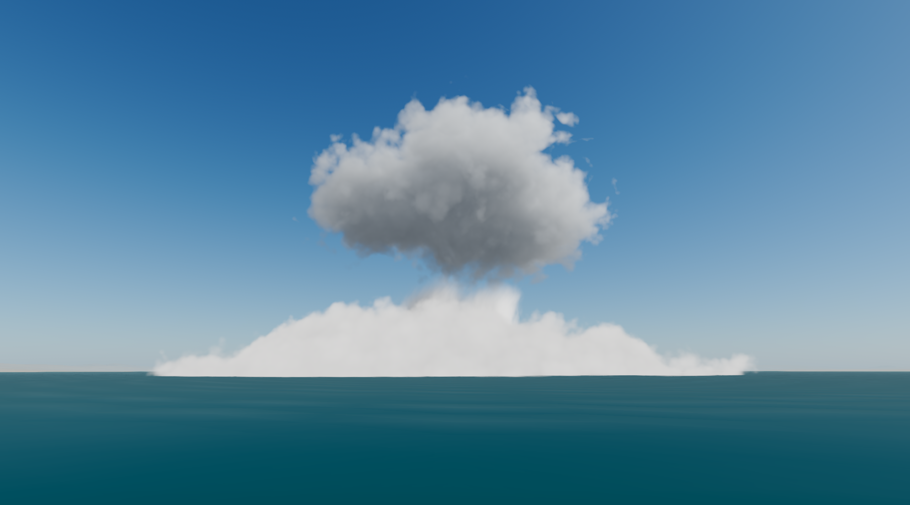
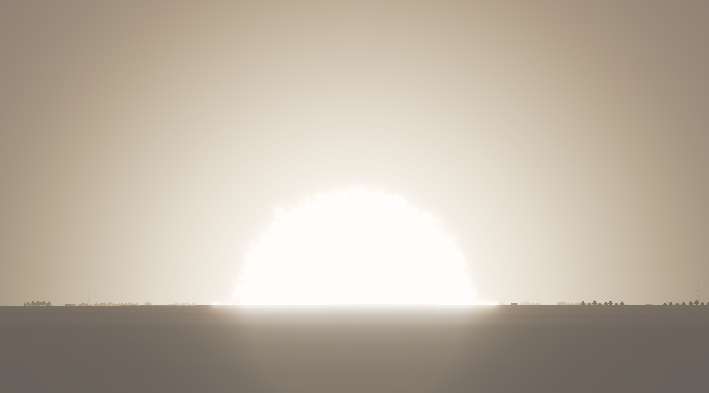

# Atomic Bombs · Claude Opus 5.5

> 🇬🇧 **English version:** [README_EN.md](README_EN.md)

Игра на Godot 4.7.2 о масштабе взрывов. Ты стоишь в бетонном бункере наблюдения на краю пустынного
полигона, запускаешь одну из **20 исторических бомб** — строго по возрастанию мощности, от 500-фунтовой
Mk 82 (≈0,1 т ТНТ) до 50-мегатонной «Царь-бомбы» — и смотришь на взрыв через панорамное окно: вспышка,
огненный шар, ударная волна, пыль, облако-гриб, волна доходит до бункера, а звук приходит через секунды
или минуты.

Игру **целиком сделал ИИ — Claude Opus 5.5 в Claude Code** по одному большому промпту
([на русском](PROMPT_atomic_bombs_RU.md) · [оригинал на английском](PROMPT_atomic_bombs.md)): код, шейдеры,
модели, физика, звук, тесты и документация. Человек только ставил задачи и сгенерировал звуки взрывов в
ElevenLabs по промптам, которые написал ИИ.

<p align="center">
  
  
  
  
</p>

## ⬇️ Скачать и запустить

### **[Скачать AtomicBombs.exe](https://github.com/Prokopiy8247/Opus5-5-Atomic-Bombs/releases/latest/download/AtomicBombs.exe)** (Windows 10/11, 64 бит, ~119 МБ)

1. Скачай файл по ссылке выше (или со страницы [Releases](https://github.com/Prokopiy8247/Opus5-5-Atomic-Bombs/releases/latest)).
2. Запусти его двойным щелчком. Устанавливать ничего не нужно: вся игра — это один файл.
3. Если Windows покажет окно «Система Windows защитила ваш компьютер» — нажми **«Подробнее» → «Выполнить в любом
   случае»**. Так бывает со всеми программами без платной цифровой подписи.

👉 **Подробный гайд для новичков** (что нажимать в игре, что делать, если не запускается, как удалить):
**[HOW_TO_RUN_RU.md](HOW_TO_RUN_RU.md)**

### Системные требования

- Windows 10 или 11, 64 бит.
- Видеокарта с поддержкой DirectX 12. Взрывы — тяжёлая объёмная графика, поэтому лучше дискретная видеокарта.
  Игра разрабатывалась и проверялась на RTX 5070. Качество подстраивается автоматически, его можно поменять
  в меню («КАЧЕСТВО»).
- ~120 МБ на диске.

## 💣 20 бомб

| № | Бомба | Год | Страна | Мощность (ТНТ) |
|---|---|---|---|---|
| 1 | Mk 82 | 1954 | США | 0,1 т |
| 2 | Mk 84 | 1960 | США | 0,5 т |
| 3 | «Толлбой» | 1944 | Великобритания | 3 т |
| 4 | «Гранд Слэм» | 1945 | Великобритания | 6,6 т |
| 5 | GBU-43/B MOAB | 2003 | США | 11 т |
| 6 | W54 «Дэви Крокетт» | 1962 | США | 18 т |
| 7 | АВБПМ «Отец всех бомб» | 2007 | Россия | 44 т |
| 8 | B61 мод. 12 | 2020 | США | 0,3 кт |
| 9 | «Грейбл» | 1953 | США | 15 кт |
| 10 | «Малыш» (Хиросима) | 1945 | США | 16 кт |
| 11 | «Тринити» («Гаджет») | 1945 | США | 21 кт |
| 12 | «Бейкер» (Crossroads) | 1946 | США | 23 кт |
| 13 | «Седан» (Plowshare) | 1962 | США | 104 кт |
| 14 | «Айви Кинг» | 1952 | США | 500 кт |
| 15 | B83 | 1983 | США | 1,2 Мт |
| 16 | РДС-37 | 1955 | СССР | 1,6 Мт |
| 17 | «Айви Майк» | 1952 | США | 10,4 Мт |
| 18 | «Касл Браво» | 1954 | США | 15 Мт |
| 19 | Испытание № 219 | 1962 | СССР | 24,2 Мт |
| 20 | «Царь-бомба» (АН602) | 1961 | СССР | 50 Мт |

Все размеры и времена взяты из опубликованной физики (Гласстон и Долан, Флетчер, стандарт DNA для 1 кт,
модель облака Миллера, Кингери–Булмаш для обычной взрывчатки) и из измеренных значений по каждой бомбе
(`docs/RESEARCH_NOTES.md`). Вся графика процедурная — никаких скачанных моделей и текстур. Звуки взрывов
и ракеты — записи, сгенерированные для проекта в ElevenLabs и подстраиваемые в реальном времени под
дистанцию и атмосферу; все остальные звуки синтезируются в коде. Сведений о конструкции оружия в игре нет.

## 🎮 Управление

| Клавиша | Действие |
|---|---|
| Мышь | осмотреться (правая кнопка мыши показывает/скрывает курсор) |
| Колесо мыши | бинокль (угол обзора 80° → 3°, плавно; при сильном зуме приближаешься к амбразуре) |
| Tab | меню-терминал |
| Enter | пуск (в меню); ↑ ↓ — выбор бомбы |
| R | сброс |
| Пробел | пауза |
| `[` / `]` | замедлить / ускорить время (0,05× … 4×) |
| C | режим оператора (свободная камера снаружи: WASD, Q/E вверх/вниз, Shift быстрее, Ctrl медленнее) |
| 1–4 | ракурсы оператора: бункер, ударная волна сбоку, нижний ракурс на облако, облёт |
| T | время суток (рассвет, полдень, закат, ночь; для «Тринити» в обзорных рендерах ещё исторические предрассветные сумерки) |
| H | влажность (сухо → влажно; влияет на дымку и облака Вильсона). Пока не поменяешь, у каждой бомбы историческая влажность места испытания (атоллы Тихого океана и Хиросима влажные, Невада сухая) |
| F1 | скрыть/показать HUD |
| F11 / Alt+Enter | полный экран ↔ окно |
| F12 | скриншот (сохраняется в `%APPDATA%\Godot\app_userdata\Atomic Bombs Opus 5.5\screenshots`) |
| Esc | меню выхода «Выйти из игры?» (симуляция на паузе): Esc ещё раз или «ПРОДОЛЖИТЬ» — вернуться, Enter или «ВЫЙТИ» — выйти. Кнопки «ВЫХОД» в терминале и на экране разрушенного бункера открывают тот же диалог |

Меню-терминал (по умолчанию на русском, переключатель RU/EN внизу справа) показывает 20 бомб: название
(русское и оригинальное), год и страну, мощность (кт/Мт и тонны ТНТ), тип и высоту подрыва, проверенную
справку, отметку достоверности, вращающуюся 3D-модель в натуральную величину и логарифмическую шкалу
мощности. Ползунок дистанции логарифмический (0,5–200 км), есть кнопка «рекомендуемая дистанция» и азимут
±30°. Под ним — время полёта, расчётные зоны поражения (стёкла 1 psi, дома 5 psi, ожоги 3-й степени, бетонные
здания 20 psi), ожидаемое давление и тепловой импульс у бункера. Опасная дистанция требует подтверждения.

## 💥 Что происходит при пуске

Ракета-носитель со стартовой площадки слева впереди несёт бомбу по сжатой баллистической дуге (6–25 с;
тяжёлые бомбы опускаются на парашюте; контактные, подземные и подводные — падают в цель). При подрыве:

- **Вспышка и адаптация глаза:** двойной тепловой импульс (первый УФ-пик, провал в t_min, второй максимум
  в t₂ = 0,0417 W^0,44 с), засветка, затем модель адаптации глаза/камеры (до ~10 ступеней, когда огненный шар
  заполняет бинокль), которая восстанавливается за секунды.
- **Огненный шар:** рэймарчинговый объём, рост по Седову–Тейлору с ограничением по измеренному максимуму,
  цвет абсолютно чёрного тела по температуре из закона Стефана–Больцмана, конвективные ячейки, дымная
  оболочка, остывание.
- **Ударная волна:** преломляющий расширяющийся фронт, пылевой вал по земле с вариантами маховской ножки и
  предвестника, реальное время прихода по данным DNA; бункер трясёт с рассчитанным избыточным давлением,
  сыплется пыль, мигает свет, при 10 psi трескается окно, при ≥ 25 psi бункер разрушается.
- **Облако:** огненный шар → вихревой тор-шапка с «цветной капустой», красно-бурые оксиды азота, которые
  белеют, пылевая ножка с обратными ветрами, снос и сдвиг ветром, кольца конденсации, ледяные шапки,
  двухъярусные шапки у самых мощных, тень облака на земле, свечение изнутри ночью.
- **Земля:** воронка и выброс грунта (участок рельефа высокого разрешения вокруг эпицентра), опалённая
  земля и тринитит, баллистические обломки, вспучивание грунта при подземных взрывах (купол «Седана»,
  камуфлеты «Толлбоя» и «Гранд Слэма»), базисные волны («Бейкер», «Седан»), лагуна с волнами для «Бейкера»,
  снег для арктических испытаний.
- **Объекты полигона** в кольцах по радиусам давления конкретной бомбы (дома, деревья, машины, вышки, мост,
  бункеры, ангар, самолёты) разрушаются в физически правильном порядке и загораются выше своих тепловых порогов.
- **Звук:** у каждой бомбы своя запись взрыва, как его слышно из бункера на рекомендуемой дистанции
  (ElevenLabs Sound Effects, промпты написаны по рассказам очевидцев и акустике взрывов —
  `docs/ELEVENLABS_PROMPTS.md`; запись нарезана, выровнена по громкости и разделена на удар и раскатистый
  гул скриптом `tools/process_samples.py`). При пуске `scripts/audio/blast_samples.gd` подстраивает её под
  выстрел: громкость следует за пиковым давлением у бункера (500-фунтовая бомба на 2 км — около −22 LUFS,
  «Царь-бомба» на 150 км — около −11 LUFS, 100-кг бомба в 15 км днём — глухой стук, в 50 км — тишина);
  поглощение в воздухе по ISO 9613-1 и дневная зона акустической тени формируют шестиполосный эквалайзер
  (дальше — глуше, ближе — звонче); вдали гул растёт относительно удара; инверсия на рассвете/ночью добавляет
  второй, более поздний и глухой приход; у мегатонн после 30-секундной записи минутами катится гул; взрыв,
  который дребезжит стёклами, дребезжит окном бункера; направление на взрыв немного панорамирует звук.
  Звук приходит ровно с ударной волной, а замедление, пауза и офлайн-рендер остаются синхронными. Ракета
  тоже записана (запуск с синтезированным хлопком давления, затем потрескивающий рёв полёта). Между
  событиями в бункере тихо; сейсмический толчок перед воздушной волной, обломки и стекло в бункере,
  инфразвуковой удар у мегатонн, звон в ушах после близких взрывов и свист падающей бомбы синтезируются.
  Пособытийный синтез взрыва (`scripts/audio/blast_synth.gd`) остаётся запасным вариантом для события
  без записи.

## 🤖 Как это сделано

- Весь проект написал **Claude Opus 5.5** (Claude Code, автономная работа с субагентами и воркфлоу) по промпту
  [PROMPT_atomic_bombs_RU.md](PROMPT_atomic_bombs_RU.md). Все коммиты в истории — его.
- **Около 12,5 часов активной работы, 6 543 запроса к модели, ~8,7 млн выходных токенов, ≈ $645 по ценам API.**
  Подробности, хронология и методика подсчёта — в `docs/PROJECT_STATS.md`.
- Перед написанием кода ИИ провёл исследование по каждой бомбе с источниками (`docs/RESEARCH_NOTES.md`,
  `docs/research_parts/`), а потом три цикла независимой «арт-дирекции»: отдельные агенты смотрели рендеры и
  искали, что выглядит фальшиво (`docs/reviews/`).
- Рабочие журналы ИИ в `docs/` (исследования, решения `DECISIONS.md`, прогресс, QA-отчёт, статистика) —
  на английском, как он их вёл. `docs/01_BOMBS_REFERENCE.md`, `02_PHYSICS_REFERENCE.md` и
  `03_GODOT_REFERENCE.md` — справочники к промпту (на русском).

## 🛠️ Для разработчиков

### Запуск из исходников

- Нужен **Godot 4.7.2-stable** ([godotengine.org](https://godotengine.org/download/archive/4.7.2-stable/)).
- **Играть:** двойной щелчок по `run.bat`. Он ищет Godot (переменная окружения `GODOT`, затем путь установки на
  машине разработчика, затем `PATH`), при первом запуске делает импорт ресурсов и запускает игру в окне.
  Проще всего указать путь к Godot так: `set GODOT=C:\путь\к\Godot_v4.7.2-stable_win64.exe`, затем `run.bat`.
- **Сборка одного exe:** двойной щелчок по `build.bat` (нужны шаблоны экспорта: Editor → Manage Export Templates).
  Экспортирует пресет «Windows Desktop» (`export_presets.cfg`, релизный шаблон, данные встроены в exe) в
  `build\AtomicBombs\`: `AtomicBombs.exe` (~119 МБ, вся игра в одном файле) и `AtomicBombs.console.exe`
  (необязательный: запускает ту же игру и показывает лог в консоли). Папку можно копировать куда угодно.
  Тестовые режимы работают и в сборке: `AtomicBombs.console.exe -- --menu_drive --audio_log --out C:\some\dir`.
  Количественный самотест (`scenes/selftest.tscn`) и скрипты `tools/` в сборку не входят (релизные шаблоны не
  запускают сцену из командной строки); запускай их через редактор.
- **Офлайн-кинорендер (PNG-кадры + WAV, 60 к/с, по умолчанию 4K):**
  `run_cinematic.bat [бомба 1-20] [секунды] [ШxВ] [время суток] [ракурс]`, например
  `run_cinematic.bat 20 90 3840x2160 dawn bunker`. Кадры пишутся в `movie\`. Склейка:
  `ffmpeg -framerate 60 -i movie\b20_frame%08d.png -i movie\b20_frame.wav -c:v libx264 -crf 14 -pix_fmt yuv420p tsar.mp4`.
  В режиме записи игра ставит максимальное качество (`OS.has_feature("movie")`). Размер кадра задаёт временный
  `override.cfg`, который скрипт создаёт и удаляет (Movie Maker в Godot пишет в базовом размере вьюпорта и
  игнорирует `--resolution`). Кадр рендерится ~1,5 мс, но кодирование PNG в Godot долгое (~0,3 с на кадр 1080p,
  ~1 с в 4K), поэтому 90-секундный ролик в 4K пишется больше часа.

Проект использует драйвер D3D12 (на машине разработчика он оказался чуть быстрее Vulkan; работают оба).

### Архитектура

```
scenes/main.tscn            корень (scripts/core/main.gd строит всё процедурно)
scenes/selftest.tscn        количественные тесты (tools/selftest.gd)
scripts/core/               game.gd (автозагрузка: состояние, данные, локализация), main.gd (игровой цикл,
                            ввод, автокачество, автопилот для записи), player_camera.gd, args.gd
scripts/physics/            blast_physics.gd — все формулы (огненный шар, импульс, давление, время прихода,
                            тепло, облако, воронка, облака Вильсона, масштабирование обычных ВВ)
scripts/fx/                 explosion_profile.gd (физика + арт → состояние каждого слоя как чистая функция
                            возраста взрыва), explosion.gd (униформы, свет, глобальные параметры, события),
                            fx_layers.gd (ударная волна, пылевой вал, оболочка Вильсона, обломки), launcher.gd,
                            fx_resources.gd (3D-текстуры шума)
scripts/world/              terrain.gd + terrain_math.gd (клипмап + участок у эпицентра; одинаковая функция
                            высоты на CPU и GPU с кривизной Земли), environment_ctl.gd (небо, солнце/луна,
                            воздушная перспектива, время суток, адаптация глаза), bunker.gd, water_pond.gd,
                            range_objects.gd
scripts/audio/              sound_manager.gd (шины, планирование), blast_samples.gd (записи, подстроенные под
                            каждый взрыв), audio_synth.gd (процедурный синтез), blast_synth.gd + blast_dsp.gd +
                            blast_params.gd (пособытийный синтез взрыва, запасной вариант)
assets/audio/samples/       обработанные записи (blast/NN_id_front|tail.ogg, rumble_loop.wav,
                            bunker_rattle.ogg, rocket_ignite.ogg, rocket_loop.wav) + samples.json
scripts/ui/                 ui_root.gd, terminal_menu.gd, hud.gd, ui_theme.gd
scripts/bombs/              bomb_models.gd (20 процедурных моделей бомб, ракета-носитель, парашют)
scripts/tools/              shot_rig.gd (детерминированные скриншоты), qa_driver.gd (QA-матрица)
shaders/                    explosion_volume (рэймарчинг огненного шара и облака), terrain, sky, atmos (общая
                            воздушная перспектива), shockwave, dust_wall, wilson, debris, water, glass, destructible
data/                       bombs.json (генерируется tools/gen_bombs.py из tools/bomb_profiles.py, настроек
                            цикла 3 tools/profiles_c3/group_[A-E].py и data/research_values.json),
                            locale.json (все строки интерфейса RU/EN), noise_fbm.bin / noise_billow.bin
                            (бесшовный 3D-шум, tools/gen_noise.py)
tools/                      gen_bombs.py, gen_noise.py, render_all.py, make_screens.py, selftest.gd,
                            fps_report.py, qa_tables.py, usage_report.py (+ prices.json), модульные тесты
                            test_audio.gd / test_ui.gd / test_models.gd / test_range.gd
docs/                       задание, справочники, RESEARCH_NOTES, DECISIONS, PROGRESS, TIMELOG, QA_REPORT,
                            PROJECT_STATS, reviews/, screens/, refs/ (в игру не входят)
```

Ключевые решения (подробно — `docs/DECISIONS.md`):

- **Всё — функция возраста взрыва.** Шейдеры получают возраст через униформ, а не `TIME`; обломки — аналитическая
  система частиц; деформация рельефа и опалённость — глобальные параметры шейдеров. Поэтому замедление, пауза,
  перемотка и офлайн-рендер детерминированы.
- **Настоящий масштаб 1:1 на float32:** наблюдатель в начале координат, эффекты рэймарчатся в локальных координатах
  относительно эпицентра, камера с reversed-Z и дальней плоскостью 420 км.
- **Кривизна Земли** (стандартная рефракция, R_eff = 8500 км) применяется к рельефу, поэтому на 100+ км основания
  взрывов, как и положено, уходят за горизонт.
- **Особенность экспозиции Godot:** неосвещённые эффекты и свои цвета тумана умножаются на глобальный параметр
  экспозиции, потому что Godot применяет экспозицию камеры только к освещённым материалам.

### Проверка

- `scenes/selftest.tscn` (запуск: `Godot_v4.7.2-stable_win64_console.exe --path . res://scenes/selftest.tscn`)
  сверяет физику с эталонными данными (радиусы огненного шара «Тринити», максимумы по Гласстону, время прихода по DNA,
  радиусы давления по Саблетту, радиусы ожогов, высоты облака по Миллеру, размеры воронок, Кингери–Булмаш),
  возрастание мощности, NaN/∞ во всех профилях на всех возрастах, безопасность рекомендуемых дистанций и утечки
  узлов/памяти за 20 взрывов подряд. Если всё прошло, печатает `READY`.
- `scripts/tools/shot_rig.gd`: `-- --bomb N --dist KM --tod T --view bunker|zoom|near|side|low|orbit --shots t1,t2 --out DIR --sheet 1 [--fps_hold N]`
  рендерит детерминированные кадры на любом возрасте взрыва, контактные листы и FPS по возрастам.
- `scripts/tools/qa_driver.gd`: `-- --qa_matrix` запускает все 20 бомб на рекомендуемой / в 3 раза ближе / в 3 раза
  дальше дистанции днём и ночью через настоящий путь пуска, затем проверяет замедление, паузу, оператора, ракурсы,
  HUD, RU/EN и время суток.
- `run.bat -- --menu_drive [--bomb N] [--out DIR] [--audio_log]`: управляет настоящим меню (выбор бомбы, ползунок
  дистанции, кнопка ПУСК), снимает скриншот каждого шага, а с `--audio_log` ждёт прихода взрыва к бункеру и проверяет,
  что сыграла запись именно этой бомбы (`--audio_log` также печатает план подстройки и каждый сыгранный слой звука).
- `tools/test_audio.gd` (`--headless -s res://tools/test_audio.gd -- --nospec`): 145 проверок звука (генерация,
  уровни, швы петель, шины, таймлайны, пауза/перемотка/замедление, устойчивость, синтез, записи: режим сэмплов,
  эквалайзер/панорама, эхо, дребезг, мегатонный гул, приглушение, записанная ракета); `tools/audio_preview.tscn` +
  `tools/audio_plot.py` экспортируют и строят графики синтезированных событий.
- Записи: `python tools/process_samples.py` пересобирает `assets/audio/samples` из исходных записей в папке
  `Звуки взрывов\` (её нет в git; потом нужен повторный импорт: открыть редактор или `--headless --path . --import`;
  `run.bat` сам импортирует только при первом запуске); `tools/sample_plan_report.tscn` (`--headless --path .
  res://tools/sample_plan_report.tscn [-- --json plans.json]`) печатает и проверяет план подстройки каждой бомбы по
  дистанции, времени суток и влажности; `python tools/sample_metrics.py plans.json AMB_DIR` сводит планы как игра и
  меряет громкость, шипение и длину удара.
- `tools/test_window.tscn` (в окне: `--path . res://tools/test_window.tscn`): клавиши окна в настоящей игре —
  F11 / Alt+Enter, Esc открывает и закрывает диалог выхода (пауза, курсор виден).
- `tools/fps_report.py`: FPS в реальном времени по сценариям (каждая бомба, вид из бункера и в бинокль, худший случай —
  «Царь-бомба» ночью на всех четырёх уровнях качества) → `docs/fps_report.json`.
- `tools/render_all.py` и три цикла независимой арт-дирекции (`docs/reviews/cycle1..3_art_review.json`), после
  каждого — исправления и повторный рендер; в цикле 3 пять агентов-техартистов параллельно настроили по четыре бомбы.

Результаты и FPS — в `docs/QA_REPORT.md`, известные ограничения — там же, раздел «Known limitations».

## 🎁 Бонус: гайд по Blender MCP

Короткий пошаговый гайд: как подключить Blender к Claude Code или Codex через MCP, чтобы ИИ сам создавал и
редактировал 3D-модели для проекта на Unity (или другом движке).

- 🇷🇺 [Blender_MCP_Guide_RU.pdf](Blender_MCP_Guide/Blender_MCP_Guide_RU.pdf)
- 🇬🇧 [Blender_MCP_Guide_EN.pdf](Blender_MCP_Guide/Blender_MCP_Guide_EN.pdf)

## 📜 Авторы и источники

Движок — Godot Engine 4.7.2 (лицензия MIT). Сторонних аддонов, моделей, текстур и шрифтов нет. Справочные
фотографии (только для разработки, в игру не входят), звуки и источники данных — в
[CREDITS_RU.md](CREDITS_RU.md) ([English](CREDITS.md)).
