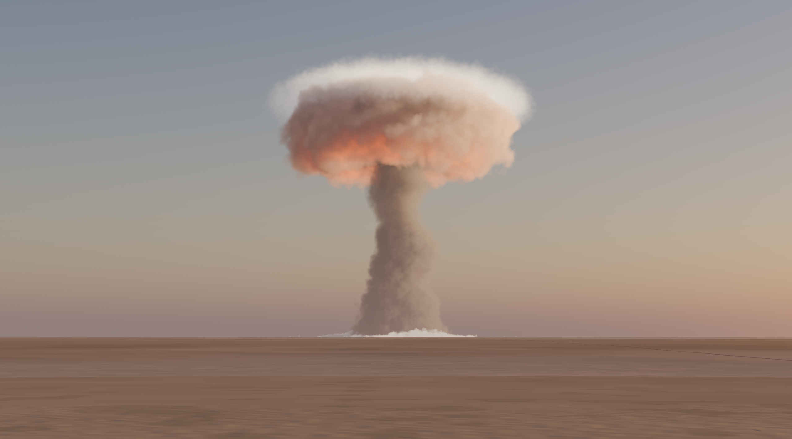
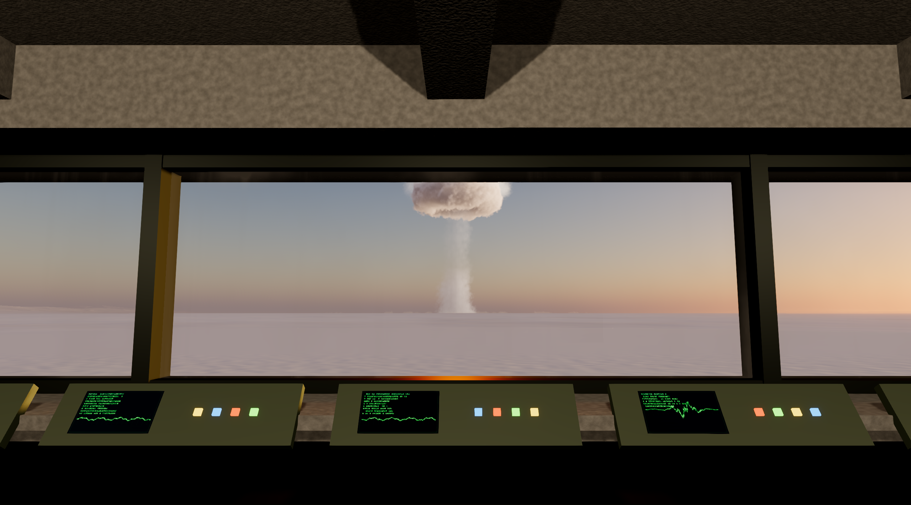
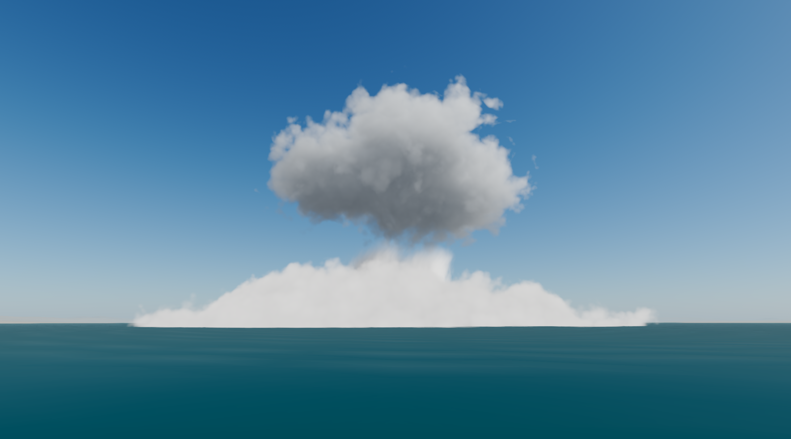
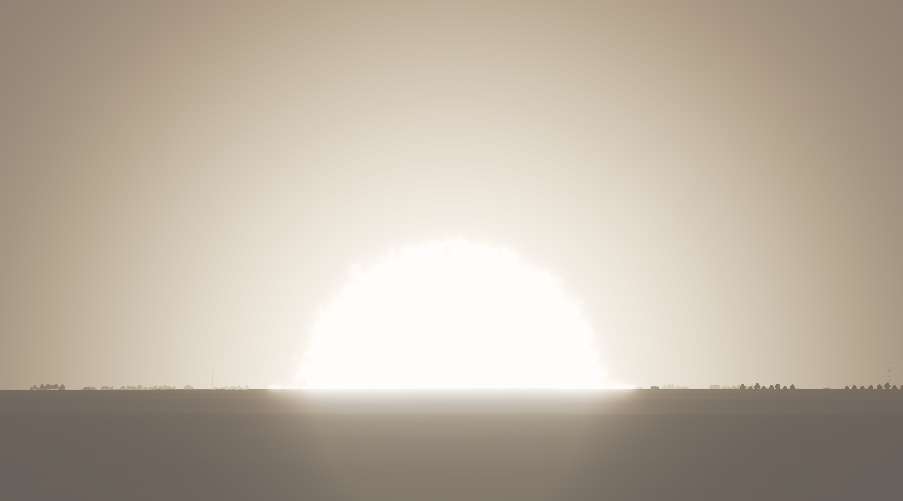

# Atomic Bombs · Claude Opus 5.5

> 🇷🇺 **Русская версия:** [README.md](README.md)

A Godot 4.7.2 game about the scale of explosions. You stand in a concrete observation bunker at the
edge of a desert test range and launch one of **20 historical bombs**, in strictly ascending yield
from a 500-lb Mk 82 (≈0.1 t TNT) to the 50-megaton Tsar Bomba, and watch the explosion through a
panoramic window: flash, fireball, shock wave, dust, cloud, the blast wave reaching the bunker and
the sound arriving seconds or minutes later.

The game was **built entirely by AI — Claude Opus 5.5 in Claude Code** from one large prompt
([PROMPT_atomic_bombs.md](PROMPT_atomic_bombs.md) · [Russian translation](PROMPT_atomic_bombs_RU.md)): code,
shaders, models, physics, sound, tests and documentation. The human only gave the tasks and generated the blast
sounds in ElevenLabs from prompts the AI wrote.

<p align="center">
  
  
  
  
</p>

## ⬇️ Download and play

### **[Download AtomicBombs.exe](https://github.com/Prokopiy8247/Opus5-5-Atomic-Bombs/releases/latest/download/AtomicBombs.exe)** (Windows 10/11, 64-bit, ~119 MB)

1. Download the file from the link above (or from the [Releases](https://github.com/Prokopiy8247/Opus5-5-Atomic-Bombs/releases/latest) page).
2. Double-click it. Nothing to install: the whole game is this one file.
3. If Windows shows "Windows protected your PC", click **"More info" → "Run anyway"**. This happens with every
   program that has no paid code-signing certificate.

👉 **Step-by-step guide for beginners** (what to press in the game, what to do if it does not start, how to remove it):
**[HOW_TO_RUN_EN.md](HOW_TO_RUN_EN.md)**

### System requirements

- Windows 10 or 11, 64-bit.
- A GPU with DirectX 12 support. The explosions are heavy volumetric rendering, so a dedicated graphics card is
  recommended. The game was developed and tested on an RTX 5070. Quality adapts automatically and can be changed in
  the menu ("QUALITY").
- ~120 MB of disk space.

## 💣 The 20 bombs

| # | Bomb | Year | Country | Yield (TNT) |
|---|---|---|---|---|
| 1 | Mk 82 | 1954 | USA | 0.1 t |
| 2 | Mk 84 | 1960 | USA | 0.5 t |
| 3 | Tallboy | 1944 | United Kingdom | 3 t |
| 4 | Grand Slam | 1945 | United Kingdom | 6.6 t |
| 5 | GBU-43/B MOAB | 2003 | USA | 11 t |
| 6 | W54 Davy Crockett | 1962 | USA | 18 t |
| 7 | ATBIP "Father of All Bombs" | 2007 | Russia | 44 t |
| 8 | B61 Mod 12 | 2020 | USA | 0.3 kt |
| 9 | Grable | 1953 | USA | 15 kt |
| 10 | Little Boy (Hiroshima) | 1945 | USA | 16 kt |
| 11 | Trinity ("Gadget") | 1945 | USA | 21 kt |
| 12 | Baker (Crossroads) | 1946 | USA | 23 kt |
| 13 | Sedan (Plowshare) | 1962 | USA | 104 kt |
| 14 | Ivy King | 1952 | USA | 500 kt |
| 15 | B83 | 1983 | USA | 1.2 Mt |
| 16 | RDS-37 | 1955 | USSR | 1.6 Mt |
| 17 | Ivy Mike | 1952 | USA | 10.4 Mt |
| 18 | Castle Bravo | 1954 | USA | 15 Mt |
| 19 | Test No. 219 | 1962 | USSR | 24.2 Mt |
| 20 | Tsar Bomba (AN602) | 1961 | USSR | 50 Mt |

Every size and time comes from published physics (Glasstone & Dolan, Fletcher, the DNA 1-kt
standard, Miller's cloud model, Kingery-Bulmash for conventional explosives) plus per-bomb measured
values from the research notes (`docs/RESEARCH_NOTES.md`). Everything visual is procedural (no downloaded models or
textures); the explosion and rocket sounds are recordings generated for this project with ElevenLabs and adapted
in real time to the distance and the atmosphere, every other sound is synthesized in code. No weapon-design
information is included.

## 🎮 Controls

| Key | Action |
|---|---|
| Mouse | look around (right mouse button toggles the cursor) |
| Mouse wheel | binocular zoom (FOV 80° → 3°, smoothed; with high zoom you lean into the embrasure) |
| Tab | terminal menu |
| Enter | launch (in the menu); ↑ ↓ select the bomb |
| R | reset |
| Space | pause |
| `[` / `]` | slow down / speed up time (0.05× … 4×) |
| C | cinematographer mode (free camera outside: WASD, Q/E up/down, Shift fast, Ctrl slow) |
| 1–4 | director angles: bunker, side view of the shock wave, low angle at the cloud, orbit |
| T | time of day (dawn, noon, dusk, night; the review renders also use a historical pre-dawn twilight for Trinity) |
| H | humidity (dry → humid; affects haze and Wilson condensation clouds). Until you change it, each bomb uses its historical site humidity (Pacific atolls and Hiroshima humid, Nevada dry). |
| F1 | hide/show HUD |
| F11 / Alt+Enter | full screen ↔ window |
| F12 | screenshot (saved to `%APPDATA%\Godot\app_userdata\Atomic Bombs Opus 5.5\screenshots`) |
| Esc | quit menu: "Quit the game?" pauses the simulation; Esc again (or CONTINUE) returns, Enter (or QUIT) quits. The QUIT buttons of the terminal and of the destroyed-bunker screen open the same dialog |

The terminal menu (Russian by default, RU/EN toggle at the bottom right) lists the 20 bombs with name (Russian +
original), year and country, yield (kt/Mt and TNT tonnes), burst type and height, a fact-checked
blurb, a confidence tag, a rotating 3D model at true scale and a logarithmic yield bar. The range
slider is logarithmic (0.5–200 km) with a "recommended distance" button and a ±30° azimuth; under it
the flight time, the estimated damage zones (glass 1 psi, houses 5 psi, third-degree burns,
concrete 20 psi) and the expected overpressure and thermal fluence at the bunker are shown. A
dangerous distance asks for confirmation.

## 💥 What happens on launch

A generic booster on the pad front-left of the window carries the bomb along a compressed
ballistic arc (6–25 s; heavy bombs finish under a parachute; contact/buried/underwater bombs
impact). At detonation:

- **Flash and eye adaptation:** double thermal pulse (first UV spike, dip at t_min, second maximum
  at t₂ = 0.0417 W^0.44 s), white-out, then an eye/camera adaptation model (up to ~10 stops when the
  fireball fills the binocular view) that recovers over seconds.
- **Fireball:** raymarched volume with Sedov–Taylor growth limited by the measured maximum,
  blackbody colour from the Stefan–Boltzmann temperature, convective cells, smoke skin, cooling.
- **Shock wave:** refractive expanding front, ground dust sweep with Mach-stem/precursor variants,
  real DNA time of arrival; the bunker shakes with the computed overpressure, dust falls, lights
  flicker, the 10-psi window cracks and at ≥ 25 psi the bunker is destroyed.
- **Cloud:** fireball → vortex-torus head with cauliflower billows, NOx red-brown that whitens,
  dust stem with afterwinds, wind drift and shear, condensation rings, ice caps, two-tier caps for
  the largest yields, cloud shadow on the ground, internal glow at night.
- **Ground:** crater and ejecta (high-resolution terrain patch around ground zero), scorch and
  trinitite, ballistic debris, ground heave for buried shots (Sedan dome, Tallboy/Grand Slam
  camouflets), base surges (Baker, Sedan), a lagoon with waves for Baker, snow for the Arctic tests.
- **Test range objects** in distance rings scaled to each bomb's pressure radii (houses, trees,
  vehicles, towers, a bridge, bunkers, a hangar, aircraft) are destroyed in the physically correct
  order and ignite above their thermal thresholds.
- **Sound:** every bomb has its own recording of the blast as heard from the bunker at the
  recommended distance (ElevenLabs Sound Effects, prompts written from eyewitness accounts and
  blast acoustics in `docs/ELEVENLABS_PROMPTS.md`; cut, levelled and split into the report and its
  rolling rumble by `tools/process_samples.py`). At launch `scripts/audio/blast_samples.gd` adapts it
  to the shot: the level follows the peak overpressure at the bunker from the game's blast physics
  (a compressive loudness map: a 500-lb bomb at 2 km is about -22 LUFS, the Tsar Bomba at 150 km
  about -11 LUFS, a 100 kg bomb 15 km away by day a faint thud, 50 km away silence); ISO 9613-1 air
  absorption of the longer or shorter path at the site humidity and the daytime acoustic shadow zone
  shape a six-band EQ (farther = duller, closer = brighter; strong shocks keep their crack); far
  away the rumble grows against the report; a dawn/night ground inversion adds a later, duller
  arrival; megatons get a rolling rumble bed for minutes after the 30-second recording; a blast
  that rattles windows but stays under the debris threshold rattles the bunker window; the burst's
  bearing pans it slightly. The sound arrives exactly with the shock wave, and slow motion, pause
  and offline renders stay in sync. The rocket is recorded too (ignition with a synthesized
  ignition-overpressure thump, then the crackling flight roar). The bunker itself is silent between
  events (no fan or hum); seismic tremor ahead of the air wave, debris and glass in the bunker,
  infrasonic thump for megatons, ear-ringing after close blasts and the falling bomb's aerodynamic
  rush (silent beyond ~5 km and under a parachute) are synthesized. The per-event blast synthesis
  (`scripts/audio/blast_synth.gd`: Friedlander/N-wave pulse, absorption, echoes, shadow zone,
  inversions) and the generic layers remain as the fallback for an event without a recording.

## 🤖 How it was made

- The whole project was written by **Claude Opus 5.5** (Claude Code, autonomous work with subagents and workflows)
  from the prompt [PROMPT_atomic_bombs.md](PROMPT_atomic_bombs.md). Every commit in the history is its work.
- **About 12.5 hours of active work, 6,543 model requests, ~8.7 M output tokens, ≈ $645 at API prices.**
  Details, timeline and method: `docs/PROJECT_STATS.md`.
- Before writing code the AI researched every bomb with sources (`docs/RESEARCH_NOTES.md`, `docs/research_parts/`),
  then ran three cycles of independent "art direction": separate agents looked at the renders and hunted for anything
  that looked fake (`docs/reviews/`).
- The AI's working logs in `docs/` (research, `DECISIONS.md`, progress, QA report, statistics) are in English, as it
  kept them. `docs/01_BOMBS_REFERENCE.md`, `02_PHYSICS_REFERENCE.md` and `03_GODOT_REFERENCE.md` are the reference
  documents that came with the prompt (in Russian).

## 🛠️ For developers

### Running from source

- Needs **Godot 4.7.2-stable** ([godotengine.org](https://godotengine.org/download/archive/4.7.2-stable/)).
- **Play:** double-click `run.bat`. It finds Godot (the `GODOT` environment variable, then the install path on the
  developer's machine, then `PATH`), runs the one-time import if needed and starts the game in a window. The easiest
  way to point it at your Godot: `set GODOT=C:\path\to\Godot_v4.7.2-stable_win64.exe`, then `run.bat`.
- **Standalone build (one exe):** double-click `build.bat` (needs the export templates: Editor → Manage Export
  Templates). It exports the "Windows Desktop" preset (`export_presets.cfg`, release template, data embedded in the
  executable) to `build\AtomicBombs\`: `AtomicBombs.exe` (~119 MB, the whole game in one file) and
  `AtomicBombs.console.exe` (optional; starts the same game and shows its log in a console window).
  The folder can be copied anywhere. Test hooks work in the build too:
  `AtomicBombs.console.exe -- --menu_drive --audio_log --out C:\some\dir`. The quantitative
  self-test (`scenes/selftest.tscn`) and the `tools/` scripts are not part of the build (release
  templates refuse to run a scene given on the command line); run them with the editor binary.
- **Offline cinematic render (PNG sequence + WAV, 60 fps, 4K by default):**
  `run_cinematic.bat [bomb 1-20] [seconds] [WxH] [tod] [view]`, for example
  `run_cinematic.bat 20 90 3840x2160 dawn bunker`. Frames go to `movie\`. Assemble with
  `ffmpeg -framerate 60 -i movie\b20_frame%08d.png -i movie\b20_frame.wav -c:v libx264 -crf 14 -pix_fmt yuv420p tsar.mp4`.
  In movie mode the game uses maximum quality (`OS.has_feature("movie")`).
  The output size comes from a temporary `override.cfg` that the script writes and deletes (Godot's
  Movie Maker records at the project's base viewport size and ignores `--resolution`). Rendering
  takes ~1.5 ms per frame; Godot's PNG encoding dominates (~0.3 s per 1080p frame, ~1 s at 4K), so a
  90 s 4K clip takes over an hour to write.

The project uses the D3D12 driver (measured slightly faster than Vulkan on the development machine; both work).

### Architecture

```
scenes/main.tscn            root (scripts/core/main.gd builds everything procedurally)
scenes/selftest.tscn        quantitative tests (tools/selftest.gd)
scripts/core/               game.gd (autoload: state, data, localisation), main.gd (game loop, input,
                            auto-quality, movie autopilot), player_camera.gd, args.gd
scripts/physics/            blast_physics.gd — every formula (fireball, pulse, overpressure,
                            arrival time, thermal, cloud, crater, Wilson, HE scaling)
scripts/fx/                 explosion_profile.gd (physics + art → state of each layer as a pure
                            function of age), explosion.gd (uniforms, lights, globals, events),
                            fx_layers.gd (shock, dust wall, Wilson shell, debris), launcher.gd,
                            fx_resources.gd (3D noise volumes)
scripts/world/              terrain.gd + terrain_math.gd (clipmap + ground-zero patch; identical
                            CPU/GPU height function with Earth curvature), environment_ctl.gd
                            (sky, sun/moon, aerial perspective, time of day, eye adaptation),
                            bunker.gd, water_pond.gd, range_objects.gd
scripts/audio/              sound_manager.gd (buses, scheduling), blast_samples.gd (the recordings
                            adapted to each shot), audio_synth.gd (procedural synthesis), blast_synth.gd +
                            blast_dsp.gd + blast_params.gd (per-event blast synthesis, fallback)
assets/audio/samples/       the processed recordings (blast/NN_id_front|tail.ogg, rumble_loop.wav,
                            bunker_rattle.ogg, rocket_ignite.ogg, rocket_loop.wav) + samples.json
scripts/ui/                 ui_root.gd, terminal_menu.gd, hud.gd, ui_theme.gd
scripts/bombs/              bomb_models.gd (20 procedural bomb models, booster, parachute)
scripts/tools/              shot_rig.gd (deterministic screenshots), qa_driver.gd (QA matrix)
shaders/                    explosion_volume (raymarched fireball/cloud), terrain, sky, atmos
                            (shared aerial perspective), shockwave, dust_wall, wilson, debris,
                            water, glass, destructible
data/                       bombs.json (generated by tools/gen_bombs.py from tools/bomb_profiles.py,
                            the cycle-3 per-bomb overrides in tools/profiles_c3/group_[A-E].py
                            and data/research_values.json), locale.json (all UI strings RU/EN),
                            noise_fbm.bin / noise_billow.bin (seam-free 3D noise, tools/gen_noise.py)
tools/                      gen_bombs.py, gen_noise.py, render_all.py, make_screens.py, selftest.gd,
                            fps_report.py, qa_tables.py, usage_report.py (+ prices.json), module
                            tests test_audio.gd / test_ui.gd / test_models.gd / test_range.gd
docs/                       task, references, RESEARCH_NOTES, DECISIONS, PROGRESS, TIMELOG,
                            QA_REPORT, PROJECT_STATS, reviews/, screens/, refs/ (not shipped)
```

Key design points (details in `docs/DECISIONS.md`):

- **Everything is a function of the explosion's age.** Shaders receive the age as a uniform, never
  `TIME`; debris is an analytic particle system; terrain deformation and scorch are global shader
  parameters. Slow motion, pause, scrubbing and offline rendering are therefore deterministic.
- **True 1:1 scale on float32**: the observer is at the origin, effects are raymarched in local
  coordinates relative to ground zero, the camera uses reversed-Z with a 420 km far plane.
- **Earth curvature** (standard refraction, R_eff = 8500 km) is applied to the terrain, so at 100+ km
  the bases of explosions sink below the horizon as they should.
- **Godot exposure quirk:** unshaded effects and custom fog colours are multiplied by a global
  exposure parameter because Godot only applies the camera exposure to lit shading.

### Verification

- `scenes/selftest.tscn` (run: `Godot_v4.7.2-stable_win64_console.exe --path . res://scenes/selftest.tscn`)
  checks the physics against reference data (Trinity fireball radii, Glasstone maxima, DNA arrival
  times, Sublette pressure radii, burn radii, Miller cloud tops, crater sizes, Kingery-Bulmash),
  ascending yields, NaN/∞ in all profiles at all ages, safe recommended distances, and node/memory
  leaks over 20 consecutive explosions. Prints `READY` when everything passes.
- `scripts/tools/shot_rig.gd`: `-- --bomb N --dist KM --tod T --view bunker|zoom|near|side|low|orbit --shots t1,t2 --out DIR --sheet 1 [--fps_hold N]`
  renders deterministic frames at any explosion age, contact sheets and per-age FPS.
- `scripts/tools/qa_driver.gd`: `-- --qa_matrix` launches all 20 bombs at the recommended / 3×
  closer / 3× farther distances at noon and night in one session through the real launch path, then
  exercises slow motion, pause, cinematographer, director angles, HUD, RU/EN and time of day.
- `run.bat -- --menu_drive [--bomb N] [--out DIR] [--audio_log]`: drives the real menu (select a bomb,
  move the distance slider, press LAUNCH), takes a screenshot of every step and, with `--audio_log`,
  waits for the blast at the bunker and checks that the bomb's recording was the one played
  (`--audio_log` also prints the adapted plan and every sound layer fired).
- `tools/test_audio.gd` (`--headless -s res://tools/test_audio.gd -- --nospec`): 145 audio checks
  (generation, levels, loop seams, buses, timelines, pause/scrub/slow motion, robustness, the
  per-event synthesis path, the recordings: sample mode, EQ/pan, echo, rattle, megaton bed, duck,
  recorded rocket); `tools/audio_preview.tscn` + `tools/audio_plot.py` export and plot synthesized events.
- Recordings: `python tools/process_samples.py` rebuilds `assets/audio/samples` from the raw downloads
  in `Звуки взрывов\` (not in git; then re-import: open the editor or run `--headless --path . --import`;
  `run.bat` imports automatically only on the first run); `tools/sample_plan_report.tscn` (`--headless --path .
  res://tools/sample_plan_report.tscn [-- --json plans.json]`) prints and checks the adapted plan of
  every bomb over distance, time of day and humidity; `python tools/sample_metrics.py plans.json
  AMB_DIR` mixes the plans like the game and measures loudness, hiss and boom length.
- `tools/test_window.tscn` (windowed: `--path . res://tools/test_window.tscn`): the window keys in the real
  game - F11 / Alt+Enter full screen and back, Esc opens the quit dialog (paused, cursor visible) and closes it.
- `tools/fps_report.py`: real-time FPS per scenario (every bomb, bunker and binocular views, the
  Tsar Bomba night worst case at all four quality presets) → `docs/fps_report.json`.
- `tools/render_all.py` and three cycles of independent art-director reviews (`docs/reviews/cycle1..3_art_review.json`),
  each followed by fixes and a re-render; in cycle 3 five technical-artist agents tuned four bombs each in parallel.

Results, FPS and known limitations: `docs/QA_REPORT.md`.

## 🎁 Bonus: Blender MCP guide

A short step-by-step guide to connecting Blender to Claude Code or Codex through MCP, so the AI creates and edits
3D models for a Unity (or any other engine) project by itself.

- 🇬🇧 [Blender_MCP_Guide_EN.pdf](Blender_MCP_Guide/Blender_MCP_Guide_EN.pdf)
- 🇷🇺 [Blender_MCP_Guide_RU.pdf](Blender_MCP_Guide/Blender_MCP_Guide_RU.pdf)

## 📜 Credits

Engine: Godot Engine 4.7.2 (MIT License). No third-party addons, models, textures or fonts. Reference photos
(development only, not shipped), sounds and data sources: [CREDITS.md](CREDITS.md) ([на русском](CREDITS_RU.md)).
